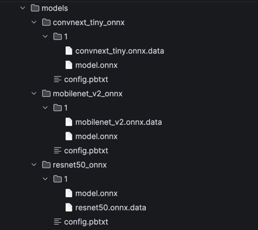

# Hosting Multiple Models on NVIDIA Triton Inference Server

Companion code for the blog post. Deploys three HuggingFace image classification models (ONNX) to Triton on **AWS SageMaker**, **Azure ML**, and **GCP Vertex AI**.

## Models

| Name | HuggingFace ID |
|---|---|
| ResNet-50 | `microsoft/resnet-50` |
| ConvNeXt Tiny | `facebook/convnext-tiny-224` |
| MobileNet V2 | `google/mobilenet_v2_1.0_224` |

## Repository Structure

```
download_models.py          # Export HuggingFace models to ONNX
models/                     # Triton model repository (ONNX Runtime backend)
Dockerfile                  # Triton 24.09 server image
aws-sagemaker-mme-with-triton.ipynb
azure-ml-endpoint-with-triton.ipynb
gcp-vertex-ai-endpoint-with-triton.ipynb
```

## Download Models

```bash
pip install torch transformers
python download_models.py
```

This exports all three models to ONNX format into the `models/` directory.


